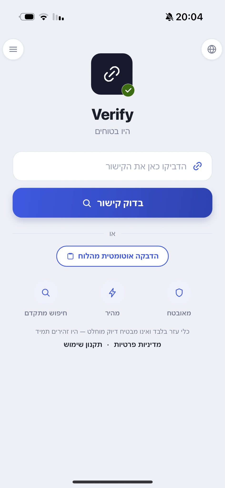
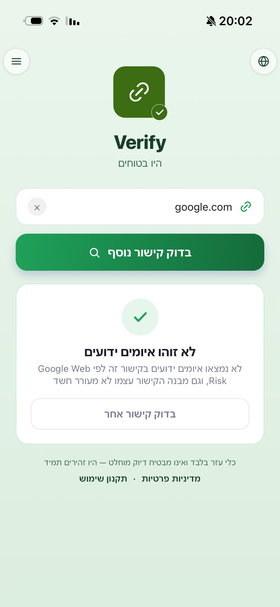
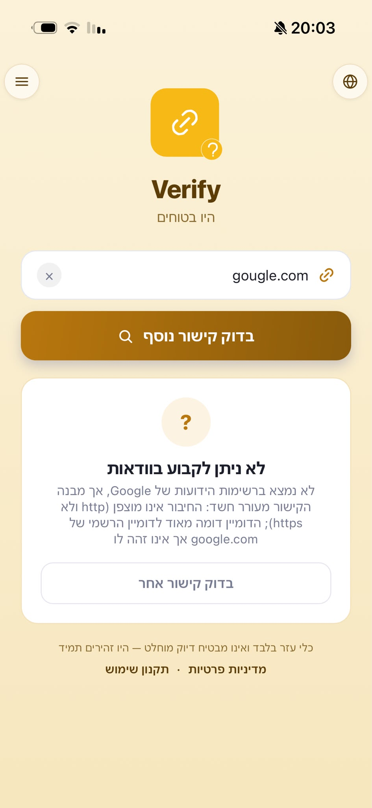
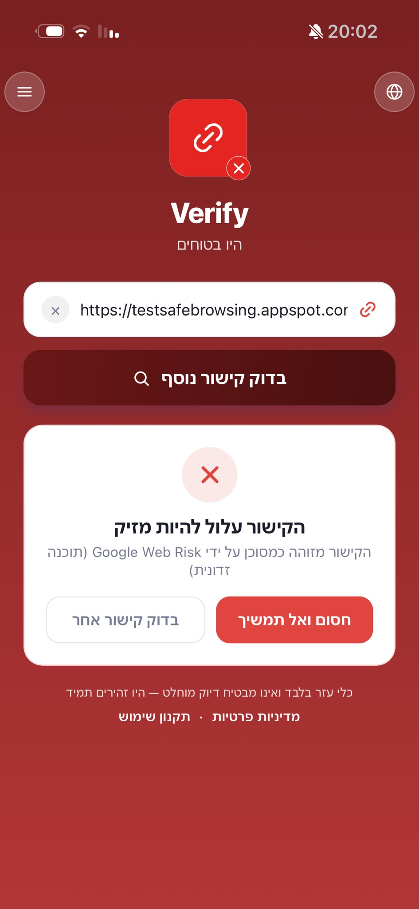

# Verify — Phishing Link Checker

A mobile app + backend that lets everyday users paste a link (from an
SMS, email, or WhatsApp message) and get an instant, color-coded
safety verdict, without ever leaving the app or exposing them to the
link itself. Fully localized (Hebrew, English, Russian, French,
Arabic) and built with screen-reader accessibility as a first-class
concern, not an afterthought.

**[Live Demo (PWA)](https://verifyweb-phi.vercel.app)** · **[Android APK](https://verifyweb-phi.vercel.app/link-checker.apk)**

## Screenshots

Three verdicts, not a single safe/unsafe toggle — the "uncertain"
state below is what a not-yet-catalogued, suspicious-looking domain
actually produces, distinct from both a confirmed threat and a clean
result.

<p align="center">
  
</p>

| 🟢 Safe | 🟡 Uncertain | 🔴 Dangerous |
|:---:|:---:|:---:|
|  |  |  |

## What it checks for, and how results are labeled

- 🟢 **No known threat detected** — not on any known threat list, and
  neither the link's structure nor its underlying infrastructure
  looks suspicious.
- 🔴 **Likely dangerous** — confirmed by Google Web Risk, or a strong
  structural red flag with no legitimate use (e.g. the `@`-trick, a
  raw IP address standing in for a domain).
- 🟡 **Uncertain** — not yet catalogued as a known threat, but the
  link's structure or infrastructure raises some suspicion. Treated
  as "be careful," not "safe."

(Deliberately not calling anything "guaranteed safe" — see *Why this
project is interesting* below for why.)

## What I built

- React Native (Expo) mobile client — PWA, Android APK, and
  Android share-intent support (share a link/message straight into
  the app from Messages, WhatsApp, etc.)
- Serverless Node.js backend on Vercel
- **Three independent detection signals**, not one: Google Web Risk,
  a structural URL heuristic, and a DNS/infrastructure risk layer
  (see below)
- Full 5-language localization (he/en/ru/fr/ar), with RTL support
- Screen-reader accessibility: roles, labels, and live-region result
  announcements throughout the main flow
- First-launch terms/consent screen, and a hosted, publicly-linked
  privacy policy page (required for app-store submission)
- Redirect resolution with connect-time SSRF protection on every hop
  (IPv4 and IPv6), under a 10-second budget for the whole chain
- Per-IP rate limiting, shared-secret request auth, and privacy-
  conscious usage stats, all backed by Upstash Redis
- 1937 automated tests across four suites (518 for backend detection
  logic + API behavior, 15 for URL extraction, 1213 for translations,
  191 for on-device message analysis),
  zero live network calls required to run any of them

## Why this project is interesting (the engineering decisions)

- **Secure server-side API key handling.** The Google API key lives
  only as a server-side environment variable on Vercel — never in
  the client bundle, so it can't be extracted by unpacking the app.
- **Three independent detection signals, combined into one score.**
  Google Web Risk only knows about *already-catalogued* threats. A
  structural heuristic (typosquatting via edit-distance, registrable-
  domain-aware brand/subdomain-decoy detection, Unicode homoglyph
  detection, encoding-obfuscation detection, and more) and a separate
  DNS/infrastructure layer (RDAP domain age, private-IP destination
  detection) each contribute signals that fold into one scoring
  system — not three competing verdicts.
- **A deliberately conservative trust model.** Only three patterns
  with *no legitimate use whatsoever* are allowed to force a
  "dangerous" verdict outright: an `@` in the URL's userinfo part
  (not in the path or query), a raw IPv4/IPv6 address in any
  notation standing in for a domain, and a private/internal IP
  written literally into the link or into any redirect's `Location`.
  These are checked on every hop of the redirect chain, not just the
  first. A hostname that merely *resolves* to a private address is
  still blocked from being fetched, but is reported as "uncertain",
  not "dangerous"; likewise a hostname that only *looks like* an IP
  (`1.2.3.4.evil.com`). Every other signal — however strong — only
  ever raises a numeric score, never bypasses Web Risk's own
  judgment. This was a deliberate design choice to keep false
  positives low, not an oversight.
- **No false alarms for small Israeli sites.** When Web Risk is clean
  and *every* signal found on a `.il` link comes from a closed list of
  weak signals (plain `http`, urgency words, a complex URL, many
  subdomains, a lone brand name, a random-looking hostname), the link
  isn't downgraded for them. Any stronger signal (typosquatting,
  subdomain decoys, homoglyphs, punycode, suspicious encoding, a
  young domain, a private DNS answer, an incomplete redirect chain)
  still yields "uncertain", and any signal added in the future voids
  the exemption by default.
- **A latency-conscious race pattern.** Web Risk and the
  infrastructure layer run *concurrently*, not sequentially — but if
  Web Risk already confirms "dangerous," the response returns
  immediately without waiting on infrastructure at all, since no
  infrastructure signal could ever override a confirmed threat. The
  infrastructure lookup is deliberately left to finish or be dropped
  in the background rather than adding an `AbortController` just to
  cancel work whose result would never be used.
- **SSRF protection enforced at connect time, with no TOCTOU gap.**
  The backend resolves redirects itself (to catch shortened links)
  over `node:http`/`node:https` with its own DNS `lookup` hook: *all*
  addresses returned for the host are classified with `ipaddr.js`,
  and if any one is not public unicast (private, loopback,
  link-local, CGNAT, `0.0.0.0/8`, `fc00::/7`, IPv4-mapped, NAT64,
  `localhost`/`*.localhost`, ...), the connection is refused before
  a socket is opened. A hostname that merely *resolves* to a private
  address is refused too, but scored "uncertain", not "dangerous" —
  DNS is the domain owner's to change. The check runs on the very answer the socket
  uses, so DNS rebinding can't slip between check and connect. The
  separate infrastructure layer still does its own independent DNS
  lookup, so a private IP found *only* there stays a scored signal
  and is never allowed to force "dangerous" on its own. The
  distinction is documented inline at the exact line where it
  matters, not just in a design doc.
- **Rate limiting + fail-safe error handling.** The public endpoint
  is protected from abuse of the free API quota, and any failure
  anywhere in the chain — Web Risk, DNS, RDAP — degrades gracefully
  to a cautious result instead of crashing or hanging; the user is
  never left without an answer.

Two more decisions are worth spelling out, because they came up in
actual product tradeoffs:

A **"safe" verdict from Web Risk still gets checked against the other
two layers before being trusted outright** — Web Risk is a list
lookup, not live content analysis, so a brand-new phishing link or a
freshly-compromised legitimate site won't be on it yet. Trusting it
blindly would give users false confidence.

**Web Risk, not Safe Browsing v4** — Safe Browsing is free but
explicitly forbids commercial use and is officially deprecated. Web
Risk is the supported, commercially-usable successor, chosen
deliberately for a project meant to be maintained long-term.

## Reading the whole message, not just the link

Paste or share a whole SMS and the app reads it **on the phone**
(`mobile/messageAnalysis.js`): which well-known body it claims to come
from (a bank, Israel Post, the Tax Authority, Bituach Leumi, ...) and
whether its wording follows a scam script (account about to be blocked,
a fee for a held parcel, a refund, a request for a code or card details).
Only those identifiers go to the server with each link — never the text.

If a message claims to come from a body and its link leads to a site that
is not that body's (and not any other known legitimate site), the answer
is **"danger"**, with the reason spelled out: *"The message is written as
if it came from Bank Hapoalim, but the link does not lead to Bank
Hapoalim's website."* Scam wording alone only raises the score. To keep
that rule from firing on ordinary messages, a body only counts as
"claimed" when its name **opens** the message (only greeting/sender words
like "Dear customer" may come first) and the message carries a scam
pattern or asks you to act; payment apps and global brands ("pay with
Bit", "I ordered on Amazon") need a scam pattern, and names that are
everyday words (כללית, בזק, פלאפון) only count as the very first word.

`npm run eval` also runs a message-level set (`eval/messages.mjs`):

| | Link only | With message analysis |
|---|---|---|
| Scam messages caught | 7.3% | 100% |
| Scam messages answered "danger" | 0% | 87.8% |
| Legitimate messages answered "danger" | — | 0 of 89 |
| Held-out legitimate messages not "safe" | — | 1 of 25 |

The 89 include 20 tricky legitimate messages an independent security
review found (a gift voucher "redeemable at Shufersal", a school message
about a raffle, a UK "National Insurance" notice): none is "danger", and
17 of them get "be careful" because their wording reads like a scam.

## Measuring accuracy

`npm run eval` runs 550 labelled legitimate links (321 Israeli; 173 of
them held out from tuning) and 297 phishing patterns through the real
handler with the network mocked, and prints false-positive rate,
recall, precision and a confusion table per category. With Web Risk
answering "clean" for everything — i.e. measuring only what is caught
*before* Google lists a link:

| | Before | After |
|---|---|---|
| False positives, legitimate links | 9.2% | 0.4% |
| False positives, Israeli legitimate | 3.9% | 0.3% |
| False positives, held-out links (never tuned on) | — | 1.2% |
| Phishing patterns caught | 60.3% | 94.6% |

The phishing set is made-up patterns modelled on scams reported in
Israel, not live samples, so these are not real-world rates — see
[`eval/README.md`](./eval/README.md). CI fails any change that crosses
`eval/thresholds.json`.

Who the well-known bodies are, their official domains, and the word
lists live in [`api/_data/known-domains.js`](./api/_data/known-domains.js),
separate from the detection logic.

## Tech stack

| Layer      | Choice                                          |
|------------|--------------------------------------------------|
| Frontend   | React Native (Expo SDK 54), PWA + Android APK targets |
| Backend    | Node.js serverless functions on Vercel (Hobby/free tier) |
| Threat API | Google Web Risk API                             |
| Domain intelligence | `psl` (registrable-domain / Public Suffix List parsing), `punycode` (IDN homoglyph decoding), `ipaddr.js` (private/reserved IP classification), public RDAP (domain age) |
| Rate limiting / stats | Upstash Redis (free tier)            |
| Build      | EAS Build (free tier, internal distribution)     |
| Tests      | Custom test runner (`test.mjs`), mocked network/DNS/RDAP, no live network calls |

## Architecture

```
                         [Expo app: PWA / APK / share-intent]
                                       │
                                POST {link, lang}
                                       ▼
                          [Vercel /api/check-link]
                                       │
                resolve redirects (connect-time SSRF guard, every hop)
                                       │
                    ┌──────────────────┼──────────────────┐
                    ▼                  ▼                  ▼
             structural           Google Web Risk     DNS / RDAP
             heuristic          (runs concurrently    infrastructure
          (typosquatting,        with infra layer —    layer (private-IP
           homoglyphs,           "dangerous" returns    destination,
           encoding, ...)        immediately, does      domain age)
                    │             not wait on infra)         │
                    └──────────────────┬──────────────────┘
                                       ▼
                              combined score / reasons
                                       ▼
                          safe · uncertain · dangerous
```

Backend API (for reference, not meant for direct browsing):
`https://verifyapp-khaki.vercel.app/api/check-link`

## What the backend actually does (`api/check-link.js`)

1. Validates the request is `POST` with a non-empty `link` string,
   checks the (optional) shared-secret header, and enforces per-IP
   rate limiting.
2. Normalizes the URL and **resolves redirects** (up to 5 hops, with
   a 10-second budget for the whole chain) so a shortened link gets
   checked at its *real* destination. Links with userinfo (`@`) are
   never fetched at all.
3. On every hop, checks the IPs the connection is actually about to
   use and refuses anything non-public (SSRF guard), before a socket
   is opened. If the chain can't be completed after at least one
   redirect — blocked, over 5 hops, or out of time — the result is
   never "safe". (A timeout on the very first hop just checks the
   link itself, since some Israeli bank and government sites block
   traffic from abroad.)
4. Starts the Google Web Risk lookup — on **every URL in the chain**,
   including the original and any blocked hop, so a flagged link
   can't hide behind a redirect to a clean site — and the
   DNS/infrastructure analysis (`api/_lib/infrastructure.js`)
   concurrently.
5. If Web Risk confirms "dangerous," returns immediately — no
   infrastructure signal could change that outcome anyway.
   Otherwise, waits for the infrastructure result and combines it
   with the structural heuristic's score into one verdict.
6. If Web Risk itself can't be reached (missing key, quota, outage),
   the answer is never "safe": the other two layers can still raise
   "danger", but on their own they top out at "uncertain". The response
   carries `"webRisk": "ok" | "unavailable"`, which the post-deploy
   smoke test (`npm run smoke`) checks against Google's test URL.
   Any other failure in that chain degrades to a cautious
   `"unknown"`/`"uncertain"` result with a `200` — the app never
   crashes or hangs, and DNS/RDAP unavailability (which is expected
   and silent for some TLDs — see `infrastructure.js`) is never
   itself treated as suspicious.
7. Records privacy-conscious, aggregate-only usage stats (no link
   content, no raw IP) via Upstash Redis.

## Security notes

- **SSRF guard checks the resolved IPs at connect time, on every
  hop**, for both HTTP and HTTPS, via a custom DNS `lookup` — so DNS
  rebinding can't get a private target past it. Private IPs written
  literally into a link are rejected even earlier. The
  DNS/infrastructure layer's own independent lookup is a *separate*,
  best-effort signal with a documented TOCTOU limitation (see above)
  — it strengthens the score but is deliberately never treated as
  equivalent proof.
- **Bounded work per request.** The whole redirect chain shares a
  10-second budget and a 5-hop limit; a chain cut short after at
  least one redirect (timeout, budget, or hop limit) degrades to
  "uncertain", never "safe".
- **CORS is restricted to the deployed PWA origin** (and its Vercel
  preview deployments, and localhost for development) rather than
  wide open — the API itself remains usable by the native app
  regardless, since CORS is a browser-only mechanism.
- **Rate limiting + shared secret** protect the public endpoint from
  casual abuse of the free Web Risk/RDAP quotas.

## Setup & deployment

The full step-by-step deployment guide (Google Cloud setup, Vercel
deployment, Expo wiring) lives in [`DEPLOYMENT.md`](./DEPLOYMENT.md).

## License

MIT — see [LICENSE](./LICENSE).
